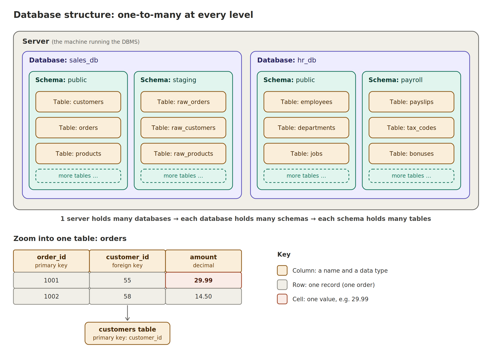

# 01 | SQL Introduction

> **Part of:** Data Engineering learning journey (started 9 October 2026)
> **Previous:** [00 | Data Engineering Foundation](00_data_engineering_foundation.md)
> **Focus:** What SQL is, what a database is, how it is structured, and the types of SQL commands

---

## 1. What is SQL?

**SQL** (Structured Query Language) is the language used to access and manipulate databases.

Think of it as the language we use to speak to the database. We send a **query** (a question or instruction) and the database sends back a result.

```sql
SELECT name, amount
FROM orders
WHERE amount > 20;
```

*In plain English: "Show me the name and amount of every order over 20."*

---

## 2. Why learn SQL?

- **High demand:** SQL appears in almost every data job (analyst, engineer, scientist)
- **Industry standard:** most databases and data tools use it, with small differences between them
- **It's how we query the database:** pipelines, transformations (including dbt) and reports all rely on it

**Why it matters for data engineering:** SQL is used constantly for cleaning, transforming and checking data inside pipelines. It is the skill I already have a head start on, so it's the first one to strengthen.

---

## 3. What is a database?

A **database** is a container that stores data in an organised format. It lives on a **server** (the physical or cloud machine) and is managed by software called a **DBMS** (Database Management System).

- **Database** = where the data is stored
- **DBMS** = the software that manages it (e.g. PostgreSQL, MySQL, SQL Server)
- **SQL** = the language used to talk to it

---

## 4. Types of databases

| Type | How data is organised | Examples |
|---|---|---|
| **Relational** | Tables (rows and columns) with relationships between tables | MySQL, PostgreSQL, Microsoft SQL Server |
| **Key-value** | Pairs of a key and a value | Amazon DynamoDB, Redis |
| **Column-based** | Data grouped by columns, good for analytics | Amazon Redshift, Apache Cassandra |
| **Graph** | Objects and the relationships between them | Neo4j |
| **Document** | Data stored as documents (JSON-like) | MongoDB |

**Focus for now:** relational databases, since that's where SQL is used most. I'll start with **PostgreSQL**.

---

## 5. Database structure

Every level can hold **many** of the level below it:

```
Server
 └── Databases (many)
      └── Schemas (many)
           └── Tables (many)
                └── Rows and Columns
                     └── Cells (values)
```



| Term | Meaning |
|---|---|
| **Server** | The machine running the DBMS. It can host multiple databases |
| **Database** | A container for related data. A server can have many |
| **Schema** | A way to group related tables inside a database. A database can have many |
| **Table** | Data in rows and columns. A schema can have many |
| **Column** | One attribute (e.g. `amount`). Each column has a **data type** |
| **Row** | One record (e.g. one order) |
| **Cell / value** | A single value where a row and column meet |
| **Primary key** | Uniquely identifies each row in a table (e.g. `order_id`) |
| **Foreign key** | A column that points to the primary key of another table, linking the two |

### Data types

Each **column** has a data type, and every cell in that column follows it. Common groups:

- **Numeric:** whole numbers, decimals (e.g. `INT`, `DECIMAL`)
- **Strings:** text (e.g. `VARCHAR`, `TEXT`)
- **Date and time:** dates, timestamps (e.g. `DATE`, `TIMESTAMP`)

*Exact names vary slightly between databases.*

---

## 6. Types of SQL commands

| Group | Full name | Purpose | Examples |
|---|---|---|---|
| **DDL** | Data Definition Language | Define or change the structure of the database | `CREATE`, `ALTER`, `DROP` |
| **DML** | Data Manipulation Language | Change the data inside tables | `INSERT`, `UPDATE`, `DELETE` |
| **DQL** | Data Query Language | Query (read) data | `SELECT` |
| **DCL** | Data Control Language | Control who can access what | `GRANT`, `REVOKE` |
| **TCL** | Transaction Control Language | Manage groups of changes | `COMMIT`, `ROLLBACK` |

**Quick memory trick:**
- DDL changes the **structure** (the container)
- DML changes the **data** (the contents)
- DQL **reads** the data
- DCL controls **access**
- TCL controls **transactions**

*Note: some courses count `SELECT` under DML, so different sources group these slightly differently.*

---

## 7. Key takeaways

- SQL is how I talk to relational databases
- A server holds many databases, a database holds many schemas, a schema holds many tables
- Primary keys identify rows; foreign keys link tables together
- Data types belong to **columns**, not individual cells
- DDL is for structure, DML is for data changes, DQL is for reading data

---

## 8. Next steps

- [ ] Install PostgreSQL locally (or use a free online SQL playground)
- [ ] Create a small database with two linked tables (e.g. `customers` and `orders`)
- [ ] Practise `CREATE`, `INSERT`, `SELECT`, `UPDATE`, `DELETE`
- [ ] Next entry: `02_sql_select_filtering.md` (`SELECT`, `WHERE`, `ORDER BY`, `LIMIT`)

---

## 9. Questions I still have

*(Add things that confused me or that I want to look up)*

- **Schemas and how they operate**
